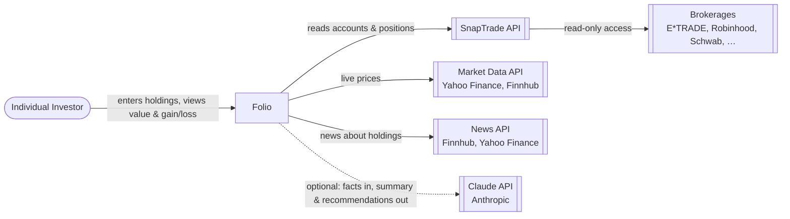
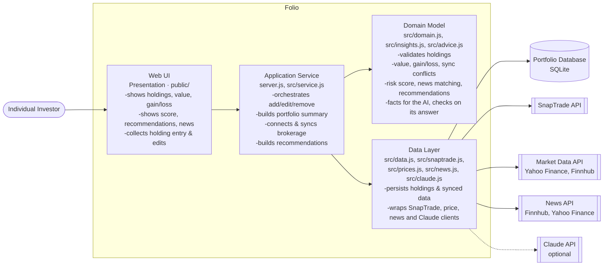
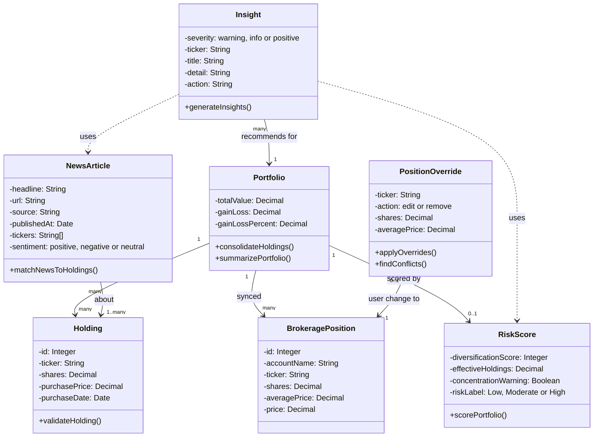
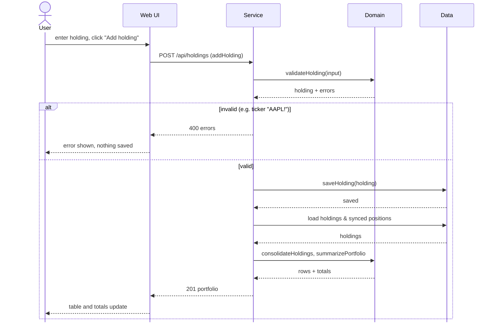
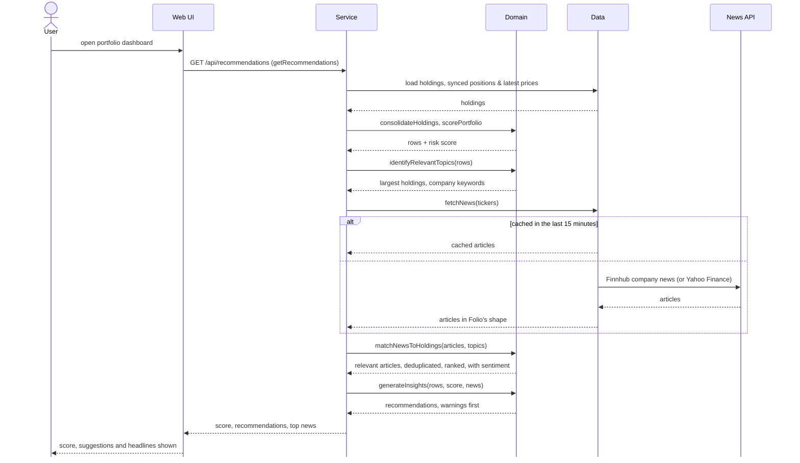

# Folio — AI Portfolio Analyzer

**Student:** [David Quinones] · **Course:** CEN 5064 Software Design, Fall 2026 · **Partner:** [ASantana0924]

## Purpose & scope

**What:** Folio is a web app that shows individual investors what they own,
what it's worth, and how they're doing, scores the portfolio's
diversification and concentration risk, and surfaces news and plain-language
recommendations tied to their holdings.

**For whom:** beginner and intermediate individual investors who hold stocks
and ETFs at one or more brokerages and want a simple, plain-language view of
their portfolio without building spreadsheets.

**Core use cases**

| # | Use case | Status |
|---|----------|--------|
| UC1 | **Build and maintain a portfolio by hand:** add a holding (ticker, shares, purchase price, purchase date), edit or remove it; invalid input is rejected | ✅ Working |
| UC2 | **Import holdings from a brokerage:** connect a brokerage read-only (E*TRADE, Robinhood, Schwab, Fidelity, …), sync and disconnect | ✅ Working |
| UC3 | **See how the portfolio is doing:** total value, gain/loss, allocation, diversification and concentration scores | ✅ Working |
| UC4 | **Get news and recommendations for my holdings:** rule-based insights and news matched to what the user owns | ✅ Working |
| UC5 | **Have my own account:** sign up and log in with a username and password; each account sees only its own portfolio; log out | ✅ Working |

**Scope:** Folio runs locally (one server, several accounts), covers US stocks and ETFs, and
only reads brokerage data (no trading). Connecting a brokerage was only a
"maybe" in the original proposal; it was added early because it is the easiest
way to fill a portfolio.

## How to run

> **Requires Node 22.13 or later** (Node 24 recommended). Check with `node -v`.
> On older versions the tests and server fail with an error mentioning
> `node:sqlite` or `--env-file-if-exists`; install a current Node from https://nodejs.org.

From the repo root after cloning:

1. **Install dependencies:** `npm install`
2. **Run the tests:** `npm test`
3. **Start the app:** `npm start` (stop it with Ctrl+C)
4. **Open Folio:** http://localhost:3000 and click **Get started** to create an
   account (username and password), or **Log in** if you have one. You land on
   your portfolio; the account button in the top right shows who's logged in
   and has **Log out**. Opening http://localhost:3000/portfolio.html while
   logged out sends you to the login page first.

If port 3000 is already in use, start on another port and open that port instead:
`$env:PORT=3001; npm start` (Windows PowerShell) or `PORT=3001 npm start` (macOS/Linux).

No `.env` file or API key is needed for this. Accounts and holdings are saved
in a local SQLite database at `data/folio.db`, created automatically on first
run. Each account has its own portfolio. If you used Folio before accounts
existed, the **first account you create takes over those holdings** (and any
connected brokerage), so nothing is lost. Passwords are stored only as salted
scrypt hashes; you stay logged in for 7 days unless you log out.

**Live prices** come from Yahoo Finance and need no key. They refresh every
minute while the page is open, or right away with **Refresh prices**. If
Yahoo can't price a ticker, Folio tries Finnhub when `FINNHUB_API_KEY` is set
in `.env` (free key at https://finnhub.io), then the brokerage's last price.
If none of these has a price, the holding shows "—" and is left out of the
totals.
Live Server doesn't work for the portfolio page, because it needs the Node server.

**Recommendations and news** live in their own tabs next to **Holdings** once
you have at least one holding.

- **Recommendations** starts with *Your portfolio at a glance*, a short
  written summary, then the diversification score (0–100) with a
  concentration-risk label, then the recommendations.
  - **Folio's findings** come from fixed rules and use your own numbers. For
    example, "TSLA is 35% of your portfolio: to bring it to 25% you could sell
    about 8 of your 20 shares (~$2,866), which would realize a loss of about
    $494, or put about $8,134 of new money into your other holdings". Others
    say how much in a broad index fund would raise your score to 70, or how
    many shares of a big winner would take back what you put in, with the US
    tax angle from your purchase dates and links to the headlines behind a news
    warning.
  - **With a Claude key** (below), Claude turns those findings into 3–6
    numbered moves, most important first, each with why, concrete steps, and
    the findings it's based on. It combines related findings (one NVDA sale
    that both takes back your money and brings it under 25%). The findings stay
    underneath, collapsed, as "How Folio worked these out". Without a key, the
    findings are the recommendations.
- **News** lists recent headlines that name your holdings, filterable by
  ticker, each marked positive or negative when the headline clearly leans one way.

News comes from Finnhub when `FINNHUB_API_KEY` is set (the same free key as
the backup price source; more articles, with summaries), otherwise from Yahoo
Finance with no key. It is cached for 15 minutes. The recommendations come
from fixed rules in `src/insights.js`.

**Optional: AI-written summary and recommendations (Claude).** Without a key,
everything works as-is from the rules. To turn it on, put an Anthropic API key
(https://console.anthropic.com → API Keys) in `ANTHROPIC_API_KEY` in `.env`
and restart. It uses Claude Haiku 5.5, the cheapest Claude model: about
$0.001 per answer. Answers are cached for 6 hours and only requested while the
Recommendations tab is open and your holdings changed, or when you click
**Regenerate**, so normal use costs cents. Set `ANTHROPIC_MODEL` to use a
different model. Claude only sees the facts Folio computed (holdings, the
score, the findings with their amounts, matched headlines), not account
details. Folio checks every number Claude writes against those facts and
removes any recommendation with a number it didn't provide. Usage is billed to
your Anthropic account. If Claude is unavailable, the page says why and shows
the findings instead. None of this is financial advice.

**Try the core use case (UC1):** click **Add holding** and enter
`AAPL, 10, 150, 2024-01-15`: it appears in the table, and it's still there after
a refresh or a server restart. Enter the ticker `AAPL!` and the Domain tier
rejects it with "Invalid ticker symbol". Click **Edit** on the row to edit or
remove the purchase.

### Optional: connect a brokerage (SnapTrade)

Everything above works without this. To enable "Connect brokerage" you need
your own free SnapTrade API key:

1. Create a **Commercial** account (not Personal) at https://dashboard.snaptrade.com,
   verify your email, and turn on two-factor authentication.
2. On the **API Keys** page, create a **test** key. Copy the **Client ID** and
   **Consumer Key** right away and keep the Consumer Key private.
3. Copy `.env.example` to `.env` and paste the two values into
   `SNAPTRADE_CLIENT_ID` and `SNAPTRADE_CONSUMER_KEY`. `.env` is gitignored —
   never commit real keys.
4. Restart `npm start`, click **Connect brokerage**, and sign in to your
   brokerage on the page that opens. You'll be sent back to Folio and your
   holdings sync automatically. **Sync accounts** refreshes them;
   **Disconnect** revokes SnapTrade's access and removes synced holdings.

Access is read-only. The free tier allows one connected user. Stocks, ETFs and
mutual funds in USD are imported; options, crypto and cash are skipped for now.

## Architecture

### N-tier architecture

Four tiers, each with its own files:

| Tier | Files | Responsibilities in Folio |
|------|-------|---------------------------|
| **Presentation** | `public/index.html`, `public/login.html`, `public/portfolio.html`, `public/account.js` | Landing page; log in / create account; account menu (username, Log out); portfolio dashboard (summary tiles, then Holdings, Recommendations and News tabs; holdings table, purchase history); dialogs to add, edit and remove holdings, connect a brokerage, and resolve sync conflicts. Sends input to the server as JSON and renders the result. **No business rules and no storage access.** |
| **Service** | `server.js` (HTTP entry), `src/service.js`, `src/auth.js`, `src/config.js` | `auth.js`: sign up, log in and out, password hashing (scrypt) and sessions; `server.js` turns the session cookie into whose portfolio a request is for, and sends logged-out requests to the login page (pages) or a 401 (API). `service.js` orchestrates each use case for that user: add/edit/remove a holding, build the portfolio view, connect/sync/disconnect a brokerage, resolve sync conflicts, build recommendations and the written summary. Asks the Domain to decide and the Data tier to load and save. `server.js` only parses requests and maps results and errors to HTTP status codes. `config.js` reads the settings from the environment once; `server.js` hands them down through `service.configure()`. |
| **Domain** | `src/domain.js`, `src/insights.js`, `src/advice.js`, `src/accounts.js` | The rules, as pure functions. `accounts.js`: what makes a valid username and password. `domain.js`: what makes a holding valid (ticker format, shares and price > 0, date not in the future); merging purchases into one row per ticker; value, total value and gain/loss (per holding and overall); allocation by ticker; applying the user's changes to synced holdings and detecting conflicts with fresh brokerage data. `insights.js`: the diversification score and concentration risk; headline sentiment; deciding which news is about which holding; the recommendation rules. `advice.js`: the facts given to the AI model, the checks on what it writes, and the rules-only summary. No I/O. |
| **Data** | `src/data.js`, `src/snaptrade.js`, `src/prices.js`, `src/news.js`, `src/claude.js` | `data.js`: all SQLite access (accounts and sessions; each user's holdings, brokerage accounts, positions, buy history, and changes to synced holdings). `snaptrade.js`: the only code that uses the SnapTrade keys or calls SnapTrade; converts its data into Folio's shape. `prices.js`: the only code that fetches market prices (Yahoo Finance, with Finnhub as a backup), with a one-minute cache. `news.js`: the only code that fetches news (Finnhub company news, with Yahoo Finance as a backup), with a 15-minute cache. `claude.js`: the only code that calls the Claude API (optional), with a 6-hour cache per set of facts. |

**Dependency rule:** dependencies point one way: Presentation → Service →
Domain, and Service → Data. The Domain depends on nothing (it imports no other
module), the Data tier never calls up into Service or Domain, and the
Presentation tier reaches the server only over HTTP. In code this is visible
in the `require` calls: `server.js` imports only `config.js`, `service.js` and `auth.js`; `service.js`
imports `domain.js`, `insights.js`, `advice.js`, `data.js`, `snaptrade.js`, `prices.js`, `news.js` and `claude.js`;
`auth.js` imports `accounts.js` and `data.js`; the four Domain files import nothing.

### C4 — Context

*Dashed = optional (only used when `ANTHROPIC_API_KEY` is set).*

### C4 — Container

*Dashed = optional (only used when `ANTHROPIC_API_KEY` is set).*

### UML — Class diagram

The core domain concepts. In code they are plain JavaScript objects, and the
operations are pure functions in `src/domain.js` and `src/insights.js`.

### UML — Sequence diagram (UC1: add a holding, built)

### UML — Sequence diagram (UC4: news & recommendations, built)

The page asks for recommendations after it shows the portfolio, so a slow news
source never delays the holdings table.

When the Recommendations tab is open, the page also asks for the written
summary and Claude's recommendations (`GET /api/advice`, `getAdvice`). The
Service builds the same findings, the Domain turns them into a brief
(`buildAdvisorBrief`), and `claude.js` sends it to Claude with a JSON output
schema, unless that exact brief was answered in the last 6 hours. The Domain
then checks the answer (`validateAdvice`), dropping any recommendation with a
number that isn't in the brief, before it reaches the page. With no key, or if
Claude fails, `fallbackAdvice` writes the summary from the rules and the page
shows the findings as the recommendations.

## Plan for the second half

A rough plan; the order and scope may shift as the project develops.

| Weeks | Focus | Use case |
|-------|-------|----------|
| 8 | Midterm: merge open work, docs current | — |
| 9–10 | Live prices, allocation breakdown, per-holding gain/loss | UC3 |
| 11–12 | Portfolio scores (diversification, concentration) and news for holdings | UC3, UC4 |
| 13–14 | Recommendations/insights, login, buffer for anything that slipped | UC4 |
| 15–16 | Polish, final docs, final deliverable | — |

**Risks**

- **Free-tier API limits** (market data, SnapTrade): cache prices and fall back to the last brokerage price.
- **Older Node versions** can't run the app: the required version is stated above, and CI runs on Node 24.

## Architecture Decision Records

Decisions live in [`docs/adr/`](docs/adr/).

| # | Decision | Status |
|---|----------|--------|
| [001](docs/adr/adr-001.md) | Use JavaScript/Node across all tiers | accepted |
| [002](docs/adr/adr-002.md) | Use SQLite via built-in `node:sqlite` for the Data tier | accepted |
| [003](docs/adr/adr-003.md) | Use SnapTrade to connect brokerage accounts | accepted |
| [004](docs/adr/adr-004.md) | Keep user edits to synced holdings separate; let the user decide on sync | accepted |
| [005](docs/adr/adr-005.md) | News from Finnhub with a Yahoo fallback; rule-based recommendations instead of an LLM | accepted, amended by 006 |
| [006](docs/adr/adr-006.md) | Claude writes the recommendations from Folio's numbers; Folio checks every number | accepted |
| [007](docs/adr/adr-007.md) | Username/password accounts with server-side sessions in SQLite | accepted |

## Weekly log

- **Week 1 (Aug 24):** Repo created; project proposal written in the README.
- **Week 2 (Aug 31):** System tier table filled in.
- **Week 3 (Sep 7):** No commits: took the Labor Day long weekend to catch up with other coursework and responsibilities.
- **Week 4 (Sep 14):** C4 Context/Container and UML class diagrams.
  - Weeks 1–4 were design and documentation by plan: Main priority was determining the scope, architecture, and stack to be used for the project.
- **Week 5 (Sep 21):** Tech stack chosen; project set
  up with CI and a smoke test; static landing page built.
- **Week 6 (Sep 28):** First working slice: manual stock entry with Domain validation
- **Week 7 (Oct 5):** With the stack, CI and first slice in place,
  features could be built on top of them, using AI-assisted development
  with a critique on each PR. Built: Node server and SQLite storage, brokerage-style
  dashboard, brokerage connection through SnapTrade, portfolio value and gain/loss,
  edit/remove holdings with sync-conflict handling, and README/ADR updates
  for the midterm.
